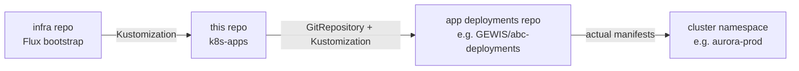

# k8s-apps

Flux GitOps registry for our Kubernetes cluster. This repo does **not** contain workloads — it declares *which* apps are deployed, from *where*, and *into which namespace*. Flux reconciles it continuously.

## How it works



Each app directory contains three files:

| File | Purpose |
|---|---|
| `source.yaml` | Flux `GitRepository` pointing at the app's deployments repo |
| `prod.yaml` | Flux `Kustomization` that deploys it into a target namespace (`prune: true`) |
| `kustomization.yaml` | Bundles the above (+ optional `rbac-prod` for the namespace RoleBinding) |

App groups (`ABC/`, `CBC/`, `board/`, `GEHACK/`, `gelift-tracker/`) are listed in the root `kustomization.yaml`, together with the `app-deployer` ServiceAccount (`service-account.yaml`, RBAC in `components/app-rbac/`).

## Deploying / changing an app

### Existing app
Edit the app's own deployments repo. This repo only needs changes if the source, branch, path, or namespace changes.

### New app
Create a directory with `source.yaml`, `prod.yaml`, `kustomization.yaml` (copy an existing one, e.g. `ABC/aurora/`), register it in its group's `kustomization.yaml`, and ensure the Flux `Kustomization` points at a path containing a valid kustomization. The source can be any Git forge, and is not restricted to the GEWIS (or even) GitHub
 
After merging the PR, the new application will automatically be picked up by Flux CD and be depoyed.


## Secrets

Never commit plain `secret.yaml` (gitignored). Encrypt with kubeseal:

```sh
export SEALED_SECRETS_CERT="https://sealed-secrets.gewis.nl/v1/cert.pem"
kubeseal -n <namespace> -f secret.yaml -o yaml > sealed-secret.yaml
```

Commit only `sealed-secret.yaml`. Dev tooling (`kubeseal`, `kustomize`, `kubectl`) comes from the Nix flake via direnv.

## Renovate

Renovate tracks Flux sources and Kubernetes manifests (`renovate.json`) and opens PRs for image/manifest updates.
